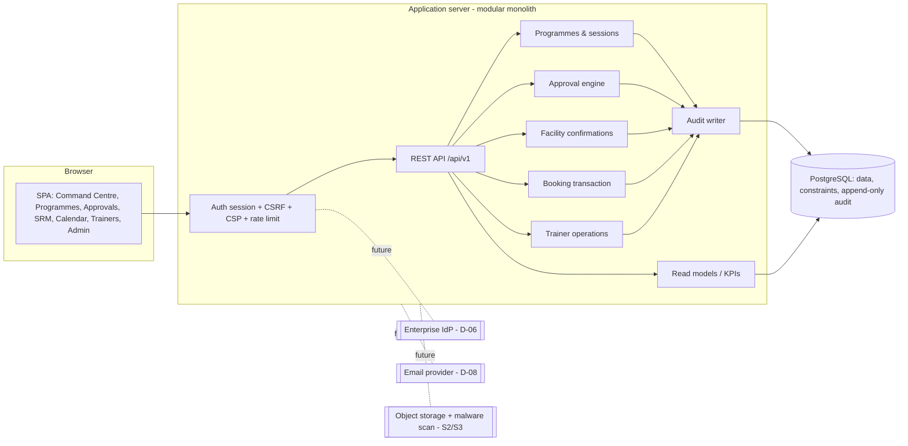
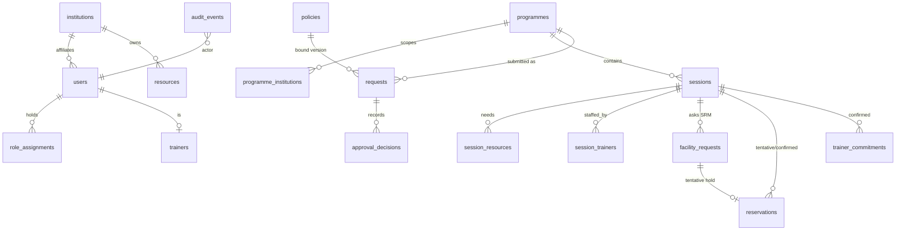
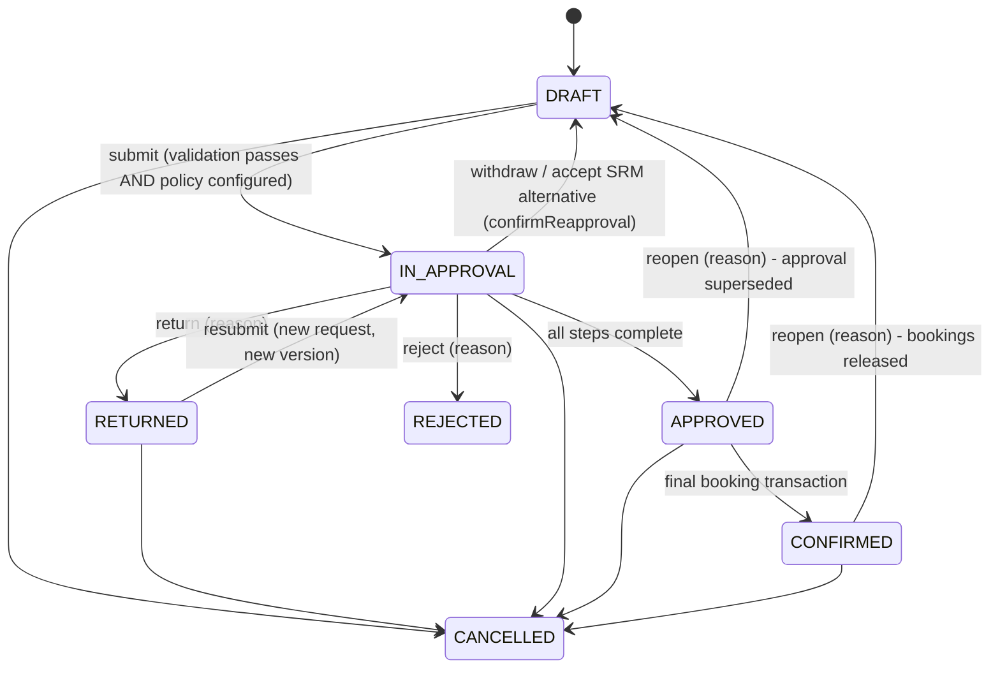

# 04 — Architecture (RECOMMENDED, provisional and reversible — not IT-approved)

## Provisional stack and rationale

| Layer | Choice | Why | Reversibility |
|---|---|---|---|
| Runtime | Node.js 22 running TypeScript directly (type-stripping) | One language end-to-end; no build step; `tsc` for type-checking | High — plain modules |
| HTTP | Fastify 5 | Mature, fast, schema-friendly, good security plugins | Medium |
| Database | PostgreSQL 16 | Serializable transactions, **exclusion constraints** for conflict-free booking, JSONB for versioned policy definitions; available as managed service on all major clouds | Low (by design — integrity lives here) |
| Client | Dependency-free ES-module SPA | Small attack surface, strict CSP, no inline scripts | High — can be replaced by React etc. |
| Tests | `node:test` against a real PostgreSQL | Tests the real constraints and concurrency, not mocks | High |

A modular monolith is preferred over microservices: one deployable, one database, clear module boundaries (`src/services/*`).

## Component view

## Entity relationships (Slice 1)

Key constraints: status `CHECK`s on every workflow table; `reservations_no_exclusive_overlap` and `trainer_no_overlap`
(GiST exclusion); one ACTIVE policy per key+provenance; one open request per programme; reasons mandatory for
reject/return/decline; audit table guarded by an update/delete trigger. Deletion: business records are never hard-deleted
once they have history (cancel / supersede instead). Retention periods are D-10.

## State machines

Facility request: `PENDING → CONFIRMED | DECLINED | ALTERNATIVE_PROPOSED → ALTERNATIVE_ACCEPTED`; any active request
becomes `SUPERSEDED` when the session’s resource, time or units change. Reservation: `TENTATIVE → RELEASED`, final booking
creates `CONFIRMED` (released on reopen/cancel).

Certificate (designed, S4): `NOT_EVALUATED → ELIGIBLE | NOT_ELIGIBLE → PENDING_APPROVAL → APPROVED (Ranjith T. P.; bound to
evidence + template + recipient versions) → ISSUED → SUPERSEDED | REVOKED`; any change to bound inputs invalidates `APPROVED`.

Communication (designed, S5): `DRAFT → QUEUED → SENT_TO_PROVIDER (accepted) → DELIVERED | BOUNCED | FAILED → DEAD_LETTER`;
`CANCELLED` / `SUPERSEDED` when the underlying event changes; relevance re-checked immediately before dispatch.

## Concurrency strategy (final booking)

1. `SERIALIZABLE` transaction; programme row `FOR UPDATE`.
2. Lock all involved resource rows, then accepted-trainer rows, in UUID order (deadlock-free ordering).
3. Recompute every readiness condition inside the transaction.
4. Insert CONFIRMED reservations / trainer commitments; the **exclusion constraints** are the final backstop.
5. Serialization failures (`40001`) retried with jittered back-off; constraint violations (`23P01`) become `409 BOOKING_CONFLICT` and are audited.

Verified by test T20 (two simultaneous bookings → exactly one confirmation), repeated runs without flakes.

## Security and privacy design

- **AuthN**: server-side sessions, random 256-bit token, only its SHA-256 stored; `HttpOnly`, `SameSite=Strict`, `Secure` in production. Demo login works only for `is_synthetic` users and never in production (startup refusal). Enterprise OIDC + MFA is D-06.
- **AuthZ**: deny by default; role × scope; object-level checks (approver named in bound step; SPOC owns resource; trainer owns invitation; programme visibility filter).
- **CSRF**: per-session token required on all mutating requests. **XSS**: strict CSP (`script-src 'self'`, no inline), DOM built with `textContent` only. Clickjacking: `frame-ancestors 'none'`.
- **Rate limiting**: global and login-specific. **Logging**: cookies and CSRF headers redacted; audit change payloads redact secret-like keys.
- **Errors**: actionable messages with correlation ID; internals never leaked.
- **Data minimisation**: Slice 1 stores no participant personal data. Production: revoke `TRUNCATE/UPDATE/DELETE` on `audit_events` from the app role; encrypt at rest (managed DB) and in transit (TLS).
- **Upload security (S2 design)**: allow-list MIME + extension + magic bytes; size and row limits; parse with formula evaluation disabled; zip-bomb limits for XLSX; quarantine until malware scan passes; preview → explicit commit (all-or-nothing per import by default); CSV/XLSX export cells beginning with `= + - @` prefixed to neutralise formula injection.
- **AI assistance (designed)**: draft-only, labelled, scoped to the caller’s readable records, no tool can approve, book, decide eligibility or send.

## Integration contracts (versioned, provider-neutral)

| Contract | Direction | Key rules |
|---|---|---|
| Authentication `auth/v1` | IdP → app (OIDC code + PKCE) | Map `sub` → `users.idp_subject`; roles stay in-app; MFA asserted via `amr`/`acr` |
| Email `notify/v1` | app outbox → adapter | Idempotency key per message; 10 s timeout; exponential retry ×5; dead-letter; signed webhooks (HMAC, timestamp ±5 min) update delivery state |
| Files `files/v1` | app ↔ object store | Pre-signed short-lived URLs; scan result gate; per-object access check |
| Certificate verification `verify/v1` | public → app | Opaque ID; returns only status, programme title, issue date, certificate type |
| Reporting export `export/v1` | app → user | Permission-checked, audited, formula-safe |
| AI `assist/v1` | app → model provider | Server-side only; prompt includes only authorised data; output stored as DRAFT |

Common error format: `{ error: { code, message, resolution, resolver, details, correlationId } }`.

## Architectural decision records

- **ADR-001 Modular monolith on PostgreSQL** — integrity (constraints, serializable tx) matters more than independent scaling. *Status: accepted (provisional).*
- **ADR-002 Policies as versioned JSON definitions with provenance** — allows the business to configure routing without code; provenance separates SIMULATION from AUTHORISED. *Accepted.*
- **ADR-003 Database-enforced booking exclusivity** — application checks for explanations, constraints for guarantees. *Accepted.*
- **ADR-004 Audit in the same transaction** — no consequential change without its audit row; blocked attempts audited separately. *Accepted.*
- **ADR-005 Exact-match facility confirmations** — a confirmation counts only for the exact session/resource/time/units it was given for. *Accepted.*
- **ADR-006 Hosting deferred** — see doc 07. *Open (D-12).*
